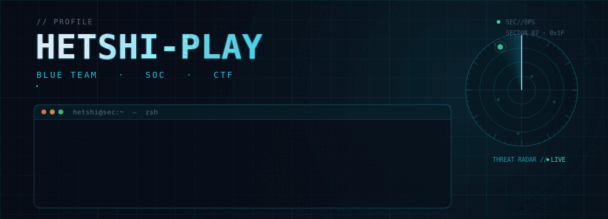

<!--
  ┌──────────────────────────────────────────────────────────────┐
  │  GitHub Profile README — HETSHI-PLAY                         │
  │                                                              │
  │  Cara pakai:                                                 │
  │  1. Buat repo baru dengan nama PERSIS: HETSHI-PLAY           │
  │  2. Jadikan repo itu Public                                  │
  │  3. Upload README.md + folder assets/banner.gif              │
  │  4. Ganti bagian yang ditandai [GANTI]                       │
  └──────────────────────────────────────────────────────────────┘
-->

<div align="center">



<a href="https://github.com/HETSHI-PLAY">
  
</a>

<br/>

<!-- GANTI: badge sosial di bawah ini dengan link kamu -->
<p>
  <a href="https://github.com/HETSHI-PLAY"></a>
  <a href="mailto:emailkamu@example.com"></a>
  <a href="https://linkedin.com/in/usernamekamu"></a>
  <a href="https://tryhackme.com/p/usernamekamu"></a>
</p>


</div>

---

## 🛡️ Tentang Saya

```bash
$ whoami
HETSHI-PLAY

$ cat /etc/profile.d/me.conf
ROLE      = "SOC Analyst / Blue Team"
FOCUS     = "Threat Detection · Incident Response · Security Automation"
SIEM      = "Wazuh"
TOOLING   = "Python · JavaScript · n8n · Docker"
INTERESTS = "DFIR · Threat Intel · CTF (picoCTF)"
MOTTO     = "Assume breach. Verify everything. Automate the boring parts."
```

- 🔭 Sedang mengembangkan **Arbiter** & **DIPTERA** — tools untuk mempercepat kerja SOC
- 🧠 Mendalami **Detection Engineering, DFIR, dan Threat Intelligence**
- 🚩 Aktif main **CTF**, terutama kategori forensics, web, dan reversing
- ⚙️ Suka mengotomasi workflow analis pakai **n8n + Python**
- 💬 Ngobrol soal **Wazuh, SIEM, log analysis, atau automation**? Siap.

---

## 🎯 Fokus Bidang

<div align="center">

| Area | Yang saya kerjakan |
| :--- | :--- |
| 🛡️ **Blue Team / SOC** | Triage alert, analisis telemetri, penulisan laporan insiden |
| 🔍 **Threat Detection** | Rule tuning, korelasi threat intel, normalisasi log |
| 🧪 **DFIR** | Investigasi artefak, timeline, dan bukti forensik |
| 🤖 **Security Automation** | Integrasi n8n, pipeline alert, tooling internal |
| 🚩 **CTF** | Web exploitation, forensics, scripting challenge |

</div>

---

## 🛠️ Tech & Tools

<div align="center">

**Languages & Scripting**


**Security & SOC**


**Workflow**


</div>

---

## 🚀 Featured Projects

### 🕵️ Arbiter
> *Airgapped SOC investigation desk* untuk telemetri **Wazuh SIEM** — normalisasi log, korelasi threat intel, penulisan kasus insiden, dan laporan forensik dalam satu tempat.

[](https://github.com/HETSHI-PLAY/Arbiter)

`SOC` · `Wazuh` · `Threat Intel` · `HTML`

---

### 🧬 DIPTERA
> Halaman web statis tanpa backend untuk mengirim **banyak form alert sekaligus** ke workflow n8n *Charlie Reporter*, memantau tiap eksekusi, lalu membaca hasilnya per kartu. Cocok untuk workflow lambat berbasis AI lokal.

[](https://github.com/HETSHI-PLAY/DIPTERA)

`JavaScript` · `n8n` · `SOC Automation`

---

### 🛰️ NexusSOC
> Toolkit SOC personal yang menyatukan berbagai tools keamanan open-source ke dalam satu dashboard, supaya analisis ancaman lebih cepat dan tidak berpindah-pindah tab.

[](https://github.com/HETSHI-PLAY/NexusSOC)

`JavaScript` · `SOC Toolkit`

---

### 🔓 zip-rar_BruteForce
> Tool Python untuk brute force arsip ZIP/RAR — dipakai untuk latihan dan riset keamanan sandi arsip.

[](https://github.com/HETSHI-PLAY/zip-rar_BruteForce)

`Python` · `MIT License`

---

### 🚩 PICOCTF-2025
> Kumpulan writeup dan script penyelesaian challenge **picoCTF 2025**.

[](https://github.com/HETSHI-PLAY/PICOCTF-2025)

`Python` · `CTF` · `Writeup`

---

## 📊 GitHub Stats

<div align="center">


<br/>


<br/>


</div>

---

## 📚 Sedang Dipelajari

- 🧪 **DFIR**: artefak Windows, memory analysis, timeline reconstruction
- 🛰️ **Detection Engineering**: Sigma rules, MITRE ATT&CK mapping
- ☁️ **Cloud Security**: dasar-dasar AWS/Azure logging & monitoring
- 🐍 **Python untuk security tooling**: parsing log, enrichment, otomasi

---

## 📫 Hubungi Saya

<div align="center">

<a href="mailto:emailkamu@example.com"></a>
<a href="https://linkedin.com/in/usernamekamu"></a>
<a href="https://instagram.com/usernamekamu"></a>
<a href="https://discord.com/users/USERNAME"></a>

<br/><br/>

<i>"The quieter you become, the more you are able to hear." — Kali Linux</i>

</div>


