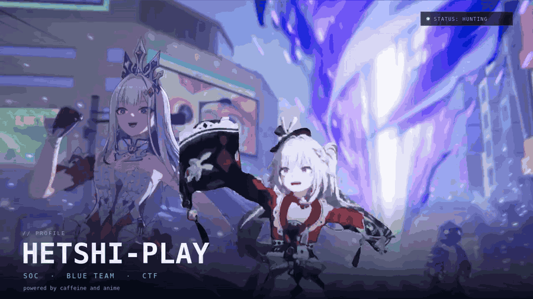
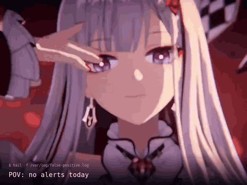
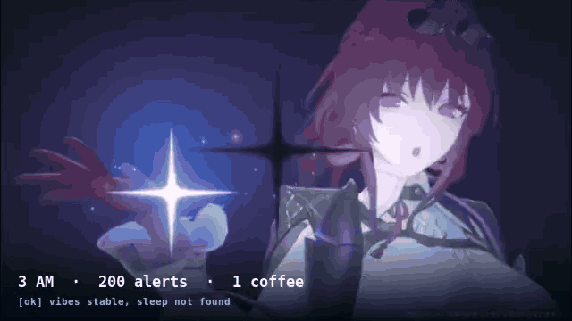

<!--
  ┌──────────────────────────────────────────────────────────────┐
  │  GitHub Profile README — HETSHI-PLAY                         │
  │                                                              │
  │  Cara pakai:                                                 │
  │  1. Buat repo baru dengan nama PERSIS: HETSHI-PLAY           │
  │  2. Jadikan repo itu Public                                  │
  │  3. Upload README.md + seluruh folder assets/                │
  │  4. Ganti bagian yang ditandai [GANTI]                       │
  └──────────────────────────────────────────────────────────────┘
-->

<div align="center">



<a href="https://github.com/HETSHI-PLAY">
  
</a>

<br/>

<!-- GANTI: badge sosial di bawah ini dengan link kamu -->
<p>
  <a href="https://github.com/HETSHI-PLAY"></a>
  <a href="mailto:emailkamu@example.com"></a>
  <a href="https://linkedin.com/in/usernamekamu"></a>
  <a href="https://tryhackme.com/p/usernamekamu"></a>
</p>


</div>

---

## 🧑‍💻 whoami

```bash
$ whoami
HETSHI-PLAY

$ cat /etc/profile.d/me.conf
ROLE      = "SOC Analyst / Blue Team"
FOCUS     = "Threat Detection · Incident Response · Security Automation"
SIEM      = "Wazuh"
TOOLING   = "Python · JavaScript · n8n · Docker"
INTERESTS = "DFIR · Threat Intel · CTF (picoCTF) · anime"
MOTTO     = "Assume breach. Verify everything. Automate the boring parts."

$ sleep 8 && echo "iya, masih bangun"
```

Singkatnya: aku suka ngulik log, bikin tool kecil buat mempercepat kerja SOC, dan sesekali lari ke CTF buat cari flag. Kalau nggak di depan terminal, ya lagi nonton anime. Keseimbangan, katanya.

---

## 🎯 Lagi Ngapain

- 🔭 Ngerjain **Arbiter** & **DIPTERA** — dua-duanya tool buat bikin hidup analis sedikit lebih waras
- 🧠 Belajar **Detection Engineering, DFIR, dan Threat Intelligence**
- 🚩 Main **CTF** (forensics, web, reversing) — mostly buat seneng-seneng
- ⚙️ Suka ngotomasi workflow SOC pakai **n8n + Python**
- 🌙 Jam produktif: malam. Jangan tanya soal tidur.

---

## 🧰 Senjata & Tools

<div align="center">

**Languages & Scripting**


**Security & SOC**


**Workflow**


</div>

---

## 🚀 Project yang (semoga) berguna

### 🕵️ Arbiter
> Meja investigasi SOC *airgapped* buat telemetri **Wazuh** — normalisasi log, korelasi threat intel, nulis kasus insiden, sampai laporan forensik. Biar analis nggak pindah-pindah tab kayak lagi belanja online.

[](https://github.com/HETSHI-PLAY/Arbiter)

`SOC` · `Wazuh` · `Threat Intel` · `HTML`

---

### 🧬 DIPTERA
> Kirim **banyak form alert sekaligus** ke workflow n8n *Charlie Reporter*, lalu pantau hasilnya per kartu. Cocok buat workflow lambat yang pakai AI lokal: isi 10 alert, klik kirim, tinggalin, balik lagi nanti.

[](https://github.com/HETSHI-PLAY/DIPTERA)

`JavaScript` · `n8n` · `SOC Automation`

---

### 🛰️ NexusSOC
> Toolkit SOC personal: tools keamanan open-source disatuin ke satu dashboard. Karena alt-tab 27 kali sehari itu bukan hobi.

[](https://github.com/HETSHI-PLAY/NexusSOC)

`JavaScript` · `SOC Toolkit`

---

### 🔓 zip-rar_BruteForce
> Tool Python buat brute force arsip ZIP/RAR. Dibuat buat latihan dan riset — bukan buat nge-hack arsip mantan.

[](https://github.com/HETSHI-PLAY/zip-rar_BruteForce)

`Python` · `MIT License`

---

### 🚩 PICOCTF-2025
> Writeup dan script penyelesaian challenge **picoCTF 2025**. Ada yang selesai, ada yang bikin nangis. Dua-duanya documented.

[](https://github.com/HETSHI-PLAY/PICOCTF-2025)

`Python` · `CTF` · `Writeup`

---

## 📊 GitHub Stats

<div align="center">


<br/>


<br/>


</div>

---

## 🍜 Fun Zone

Karena profil yang terlalu serius itu membosankan.

<table>
<tr>
<td width="50%" align="center">
  
  <br/>
  <sub><b>POV:</b> nggak ada false positive hari ini. <i>suspicious.</i></sub>
</td>
<td width="50%" align="center">
  
  <br/>
  <sub><b>3 AM:</b> 200 alert, 1 kopi, 0 tidur. Klasik.</sub>
</td>
</tr>
</table>

<div align="center">


</div>

---

## 📚 Sedang Dipelajari

- 🧪 **DFIR**: artefak Windows, memory analysis, timeline reconstruction
- 🛰️ **Detection Engineering**: Sigma rules, MITRE ATT&CK mapping
- ☁️ **Cloud Security**: logging & monitoring dasar AWS/Azure
- 🐍 **Python untuk security tooling**: parsing log, enrichment, otomasi

---

## 📫 Kontak

<div align="center">

<a href="mailto:emailkamu@example.com"></a>
<a href="https://linkedin.com/in/usernamekamu"></a>
<a href="https://instagram.com/usernamekamu"></a>
<a href="https://discord.com/users/USERNAME"></a>

<br/><br/>

<i>"The quieter you become, the more you are able to hear."</i><br/>
<sub>— Kali Linux, dan juga aku jam 3 pagi.</sub>

</div>


